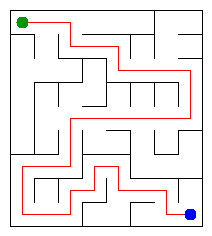

# Assignment 3. Maze Escape

Student ID: 251888  
Name: Yestaiuly Abdurrakhim  
Group: SE-2532  
Maze size (rows x columns): 9 x 8

This file is the report. How to start: `START_HERE.md`. The task: `docs/Assignment3.pdf`.

## Program output

The 13 lines my program prints on my data (`java -cp out Main`):

    Broken: 71
    Kept: 56
    Last broken wall: 94
    MST cost: 19860
    Heaviest broken wall: 739
    Path length: 33
    DFS visited: 57
    Dead ends: 21
    Zones: 10
    Largest zone: 11
    Is DAG: 0
    Flow stages: 5
    Fastest route cost: 5

My maze:

## Questions

### Mission 0. What do find and union do, and what makes them fast in your code?

`find` finds the root of the set that contains a cell. `union` joins two different sets and returns false if they are already connected. I used path compression and union by size to make these operations fast.

### Mission 1. Why is Broken always R*C - 1, and Kept always (R-1)*(C-1)?

There are R*C cells, and a connected maze without cycles is a tree. A tree with R*C vertices always has R*C - 1 edges, so exactly R*C - 1 walls are broken. The remaining number of inner walls is (R-1)*(C-1).

### Mission 2. My MST cost from Kruskal and from Prim, and why they are equal:

My MST cost is 19860. Kruskal and Prim give the same cost because both algorithms find a minimum spanning tree of the same connected weighted graph, even though they build it in different ways.

### Mission 3. Why is there exactly one path between two cells? How did you avoid a stack overflow on a huge maze?

The maze is a tree, so there is exactly one path between any two cells. I used iterative DFS with my own arrays as a stack instead of recursive DFS, so a large maze such as 1000 x 1000 does not overflow the Java call stack.

### Mission 4. Why does the second pass of Kosaraju go on the reversed graph? Why do the slides have no cycle exactly when Zones equals the number of cells?

The second pass uses the reversed graph so that DFS stays inside one strongly connected component and finds the complete zone before moving to another one. If every cell is its own zone, there is no directed cycle; therefore the slides have no cycle exactly when the number of zones equals the number of cells.

### Mission 5. Why is it enough to go through the zones in the order of their numbers? What does this pass cost?

The zone numbers are already in topological order, so every edge between different zones goes from a smaller zone number to a larger one. This means the route values can be calculated in one forward order without Dijkstra's algorithm. In my implementation, building the zone edges takes O(m), and processing the zone cost matrix takes O(z²), where z is the number of zones.

## AI use

I used ChatGPT as a helper for this assignment. I used it to explain DSU, Kruskal, Prim, iterative DFS, Kosaraju and shortest paths in a DAG, to help identify errors while running the provided checks, and to review and explain parts of my implementation. I tested the program using the provided `Check.java` and reviewed the code so that I could understand the algorithms and their purpose.

## Timing (Mission 7)

Milliseconds, 5 runs each, from `Bench`.

| maze | Kruskal | Prim |
|---|---:|---:|
| 100 x 100 | 20 ms | 13 ms |
| 300 x 300 | 67 ms | 82 ms |
| 1000 x 1000 | 1150 ms | 1693 ms |

The running time increases as the maze becomes larger because both algorithms have to process many more walls and cells. On the largest 1000 x 1000 maze, both algorithms take much longer, and in my measurements Kruskal was faster than Prim.

## Complexity

n is the number of cells and m is the number of walls or slides.

| algorithm | time | space | assumptions |
|---|---|---|---|
| DSU find and union | O(α(n)) amortized | O(n) | Path compression and union by size |
| Kruskal | O(m log m) | O(n + m) | Walls are sorted by cost and DSU is used |
| Prim | O(m log m) | O(n + m) | Adjacency lists and a priority queue are used |
| DFS | O(n + m) | O(n + m) | Iterative DFS is used instead of recursion |
| Kosaraju | O(n + m) | O(n + m) | Two DFS passes, including the reversed graph |
| Route in the zone graph | O(m + z²) | O(z²) | Zones are already in topological order; z is the number of zones |

## Before you submit

- `data/walls.txt`, `data/slides.txt` and `output/maze.png` are in the repository.
- `java tools/Check.java` shows all examples right.
- This README is filled in, including the program output and AI use section.
- The work is pushed to main with at least one commit per mission and the repository is public.
- The repository link is attached in Moodle.